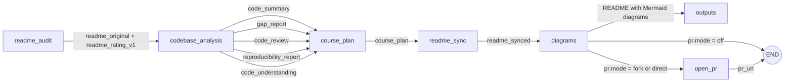
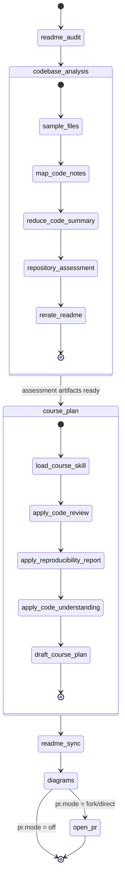

# readme-sync-workflow

A LangGraph workflow that audits a public GitHub repo's README for reproducibility, performs an evidence-based codebase analysis, and produces an improved README, a course-style learning plan, and Mermaid diagrams. Optionally opens a pull request.

## Pipeline

The workflow is a LangGraph `StateGraph`: each node reads and writes shared `RepoState`, and the consolidated repository assessment artifacts from `codebase_analysis` are passed directly into `course_plan` to improve course sequencing, design, and difficulty.



### StateGraph flow



| Node | Job | Writes to state |
|---|---|---|
| `readme_audit` | Fetch README, rate it with `rubrics/reproducibility.yaml` | `readme_rating_v1` |
| `codebase_analysis` | Sample code and perform one consolidated, evidence-based assessment of README gaps, code-review findings, reproducibility, and architecture; re-rate the README | `code_summary`, `gap_report`, `code_review`, `reproducibility_report`, `code_understanding`, `readme_rating_v2` |
| `course_plan` | Load `skills/codebase-to-course/SKILL.md` and draft a course plan using the code review, setup/test evidence, architecture, and README gaps | `course_plan` |
| `readme_sync` | Rewrite the README from gaps + summary + course plan | `readme_synced` |
| `diagrams` | Generate Mermaid diagrams, validate with mmdc (with LLM repair), splice into the README | `diagrams`, `diagram_svgs` |
| `open_pr` (optional) | Fork or branch, commit, open a PR | `pr_url` |

## Audit log

Every graph node is wrapped with a lightweight non-LLM audit logger. After each node execution, the workflow prints one compact JSON line prefixed with `AUDIT` and appends the same event to `audit_log` in state. Once `output_dir` exists, the log is also persisted to `outputs/<owner>__<repo>/audit_log.json`.

Each audit event records:

- `event`: `node_executed` or `route_decision`.
- `node`: the node that ran or made the decision.
- `changed_keys`: state keys returned by the node.
- `before` and `after`: compact summaries of changed state values, not full large strings.
- `decision` and `reason` for conditional routing after `diagrams`.

Example:

```json
{
  "event": "node_executed",
  "node": "course_plan",
  "changed_keys": ["course_plan"],
  "before": {"course_plan": {"type": "none"}},
  "after": {"course_plan": {"type": "str", "chars": 4210, "preview": "# Course plan..."}}
}
```

This makes state changes visible without asking the LLM to explain them and without printing full generated documents.

## Codebase analysis workflow

The `codebase_analysis` node runs before `course_plan` so course planning is grounded in repository evidence rather than README text alone. It uses a map-reduce workflow designed to stay efficient for small/free models:

1. Fetch the repository tree and select a prioritized sample of manifests, entry points, configs, CI files, and source files.
2. Read bounded snippets from sampled files to avoid oversized prompts.
3. Map each batch into factual notes about entry points, dependencies, configuration, commands, data flow, tests, and outputs.
4. Reduce those notes into a structured `code_summary.md`.
5. Run one consolidated repository assessment that produces:
   - `gap_report.json` for README omissions and inaccuracies.
   - `code_review.json` for static review findings, strengths, and test gaps.
   - `reproducibility_report.json` for discovered setup, run, test, configuration, and verification evidence.
   - `code_understanding.json` for main flow, components, data flow, and unknowns.
6. Re-rate the README using the code-backed gap report.
7. Pass all analysis outputs into `course_plan` so the learning plan can prioritize reproducibility, review findings, and architecture comprehension before README rewriting.

The analysis is static: repository code is read but not executed, and commands are reported as documented evidence rather than verified results.

## Course-plan design and difficulty

The `course_plan` node loads `skills/codebase-to-course/SKILL.md` plus `skills/codebase-to-course/templates/course_plan.md`. It receives the consolidated assessment artifacts from `codebase_analysis` and uses them to shape the learning path:

- `gap_report` identifies missing or inaccurate README content that should become setup/reproduction lessons.
- `code_review` highlights static findings, strengths, and test gaps that should become review and quality modules.
- `reproducibility_report` controls setup, run, test, configuration, verification, and troubleshooting checkpoints.
- `code_understanding` provides the main flow, components, data flow, and unknowns that determine module order.

Difficulty is assigned from repository evidence, not guesswork:

| Difficulty | Typical evidence |
|---|---|
| Beginner | Clear setup, simple main flow, few components, no major review/test gaps |
| Intermediate | Partial reproducibility, multiple components, unclear tests, or moderate review findings |
| Advanced | Complex architecture, operational concerns, major unknowns, or high-impact review findings |

## Quickstart

```bash
python -m venv .venv && source .venv/bin/activate
pip install -r requirements.txt
cp .env.example .env            # add HF_TOKEN and/or OPENAI_API_KEY

python run.py https://github.com/owner/repo                  # dry run, files only
python run.py https://github.com/owner/repo --provider openai
python run.py https://github.com/owner/repo --pr fork        # needs GITHUB_TOKEN
streamlit run app.py                                         # paste-a-URL web UI
python -m pytest -q tests                                    # no network or API keys needed
```

## Streamlit UI

`streamlit run app.py`, then paste a public repo URL. The sidebar picks the provider/model and takes optional API keys (kept in the session only; empty fields fall back to `.env`). The run always starts in dry-run mode and shows progress per node. Results appear as tabs: ratings (before vs after), gaps, code analysis, new README (rendered, diff, source), course plan, diagrams, and pull request. The Code analysis tab shows sampled-file coverage, static review findings, reproducibility evidence, and architecture/data-flow notes. Nothing is written to GitHub until you choose fork or direct on the Pull request tab, tick the confirmation box, and click the button (needs a GitHub token).

## Mermaid validation (mmdc)

The diagrams node renders every diagram with `mmdc` (Mermaid CLI). If a diagram fails, the render error is sent back to the model for repair, up to `mermaid_validation.max_repairs` times, and the diagram is skipped if it is still invalid. Valid diagrams are saved as `.mmd` and `.svg`.

```bash
npm install -g @mermaid-js/mermaid-cli
```

| `mermaid_validation.mode` | Behaviour |
|---|---|
| `auto` (default) | Use mmdc if it runs; otherwise only a keyword check, and a warning is recorded |
| `required` | Stop with an error if mmdc is missing or cannot start |
| `off` | Keyword check only |

In Docker, as root, or on WSL, mmdc's headless browser may refuse to start. Set `puppeteer_config: config/puppeteer-config.json` (it disables the browser sandbox, so use it only in environments you trust).

Results land in `outputs/<owner>__<repo>/`: `README.new.md`, `audit.json`, `audit_log.json`, `gap_report.json`, `code_review.json`, `reproducibility_report.json`, `code_understanding.json`, `rating_v2.json`, `course_plan.md`, `diagrams/*.mmd` (and `*.svg` when mmdc is installed), `run_summary.json`. The code review is static and limited to sampled files; setup, run, and test commands are discovered from repository evidence and are not executed.

## Reusing this for another project

| To change... | Edit |
|---|---|
| LLM provider or model | `config/settings.yaml` (`llm`) or add an adapter in `src/readme_sync/llm/` |
| What "good" means | `rubrics/*.yaml` |
| How the course plan is shaped | `skills/codebase-to-course/` |
| Which diagrams are made | `config/settings.yaml` (`diagrams`) |
| Wording of any LLM step | `src/readme_sync/prompts/*.md` |
| Audit-log summaries | `src/readme_sync/utils/audit.py` |
| Add a step | new file in `nodes/`, then register it in `graph.py` |

## PR modes

- `off` (default): nothing is written to GitHub.
- `fork`: fork to your account, push a branch there, open a PR to the original repo.
- `direct`: push a branch to the repo itself, then open a PR (you need push access).

Both PR modes need `GITHUB_TOKEN` with repo write scope. Always review generated commands before merging.
