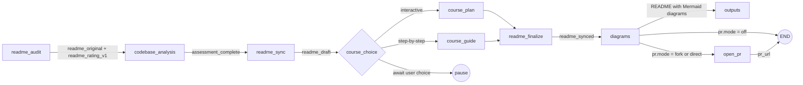
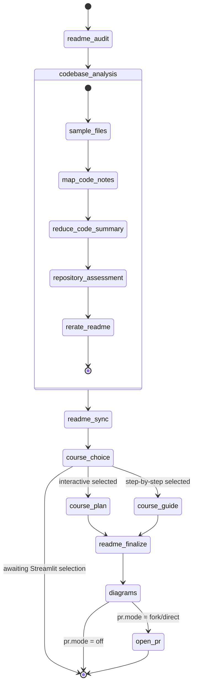

# readme-sync-workflow

A LangGraph workflow that audits a public GitHub repo's README for reproducibility, performs an evidence-based codebase analysis, and produces an improved README, either an interactive course or a concise step-by-step study plan, and Mermaid diagrams. Optionally opens a pull request.

## Pipeline

The workflow is a LangGraph `StateGraph`: each node reads and writes shared `RepoState`. After assessment, it drafts an improved README and then the Streamlit app pauses for one choice: a linked interactive course or a concise step-by-step study plan.



### StateGraph flow



| Node | Job | Writes to state |
|---|---|---|
| `readme_audit` | Fetch README, rate it with `rubrics/reproducibility.yaml` | `readme_rating_v1` |
| `codebase_analysis` | Sample code and perform one consolidated assessment; re-rate the README. Empty model summaries fall back to mapped evidence and are reported. | `assessment_complete`, `code_summary`, `gap_report`, `code_review`, `reproducibility_report`, `code_understanding`, `readme_rating_v2` |
| `readme_sync` | Draft the improved README from gaps, summary, and compact repository evidence before the format choice | `readme_draft` |
| `course_choice` | Record the selected learning format; pause after the README draft until the user chooses | `audit_log` |
| `course_plan` | Create an interactive course index and linked lesson files using the README draft and assessment artifacts | `course_plan`, `interactive_course` |
| `course_guide` | Create a concise step-by-step study plan using the README draft and assessment evidence | `course_plan`, `step_by_step_guide` |
| `readme_finalize` | Insert and verify the link to the selected learning artifact without another LLM call | `readme_synced` |
| `diagrams` | Generate Mermaid diagrams, validate with mmdc (with LLM repair), splice into the README | `diagrams`, `diagram_svgs` |
| `open_pr` (optional) | Fork or branch, commit, open a PR | `pr_url` |

## Audit log

Every graph node is wrapped with a lightweight non-LLM audit logger. After each node execution, the workflow prints one compact JSON line prefixed with `AUDIT` and appends the same event to `audit_log` in state. Once `output_dir` exists, the log is also persisted to `outputs/<owner>__<repo>/audit_log.json`.

Each audit event records:

- `event`: `node_executed` or `route_decision`.
- `node`: the node that ran or made the decision.
- `changed_keys`: state keys returned by the node.
- `before` and `after`: compact summaries of changed state values, not full large strings.
- `decision` and `reason` for conditional routing at `course_choice` and after `diagrams`.

Example:

```json
{
  "event": "node_executed",
  "node": "course_plan",
  "changed_keys": ["course_plan"],
  "before": {"course_plan": {"type": "none"}},
  "after": {"course_plan": {"type": "str", "chars": 4210, "preview": "# Course plan..."}}
}
```

This makes state changes visible without asking the LLM to explain them and without printing full generated documents.

Course-format routing decisions are also recorded by `course_choice`.

## Codebase analysis workflow

The `codebase_analysis` node runs before README drafting and course generation so outputs are grounded in repository evidence rather than README text alone. It uses a map-reduce workflow designed to stay efficient for small/free models:

1. Fetch the repository tree and select a prioritized sample of manifests, entry points, configs, CI files, and source files.
2. Read bounded snippets from sampled files to avoid oversized prompts.
3. Map each batch into factual notes about entry points, dependencies, configuration, commands, data flow, tests, and outputs.
4. Reduce those notes into a structured `code_summary.md`.
5. Run one consolidated repository assessment that produces:
   - `gap_report.json` for README omissions and inaccuracies.
   - `code_review.json` for static review findings, strengths, and test gaps.
   - `reproducibility_report.json` for discovered setup, run, test, configuration, and verification evidence.
   - `code_understanding.json` for main flow, components, data flow, and unknowns.
6. Re-rate the README using the code-backed gap report.
7. Draft the improved README using the assessment and compact supporting evidence. If summary reduction returns empty text, mapped notes or the repository tree are used and an error is added to the run state.
8. Pause Streamlit with `assessment_complete` and `readme_draft` in state. Resume routing uses these explicit state markers, not whether `code_summary` is truthy, so a selected format never repeats repository assessment.
9. Generate only the selected course output from the README draft and bounded assessment evidence. Finalize the README link deterministically after the artifact exists.

The analysis is static: repository code is read but not executed, and commands are reported as documented evidence rather than verified results.

## Choose the learning format

After `readme_sync` drafts the README, Streamlit offers two options:

- **Interactive course:** Creates `docs/interactive-course/index.md` and separate lesson Markdown files under `docs/interactive-course/lessons/`, with navigation, exercises, and checkpoints. Its skill is `skills/codebase-to-interactive-course/SKILL.md`.
- **Step-by-step study plan:** Creates a short numbered plan using the draft for orientation and documented setup/code-flow evidence as the technical source of truth. Its skill is `skills/codebase-to-study-plan/SKILL.md`.

Both branches use the same compact assessment state. The selected artifact is linked into the README without a second README-generation call. The simpler study-plan branch is the CLI default; choose the interactive option in Streamlit or pass `--course-mode interactive` on the CLI.

Token use is reduced by selecting only one learning-output branch, loading only its skills, bounding downstream context, and avoiding another model call for README link insertion. The study-plan node validates 5-8 consecutive steps with action/checkpoint labels; the interactive-course node validates 3-5 lessons and a capstone. README finalization checks required sections and order, confirms the selected artifact and interactive lessons exist, and verifies the link marker was replaced. Invalid structure is surfaced as an error rather than silently accepted; no extra LLM reviewer or automatic repair call is made for these artifact checks. The `skills/token-efficient-readme-sync/SKILL.md` documents the broader rules. LangChain LCEL composes prompt rendering and model invocation; token savings come from bounded inputs and skipped duplicate calls, not from chaining by itself.

## Skills and LLM calls

The workflow uses local Markdown skills as prompt instructions—not as separate agents, tools, or model calls. The shared `codebase-to-course` skill and exactly one mode-specific skill are loaded only after that learning branch is selected. Their instruction text is inserted into that branch's generation prompt. The unselected mode's skill is not read or sent to the model. The `token-efficient-readme-sync` skill documents implementation guidance; it is not injected into runtime prompts.

| Workflow step | Prompt/model work | Skills passed to the model |
|---|---|---|
| README audit | `readme_audit`; structured rating, with one JSON-repair call if parsing fails | None |
| Codebase analysis | `code_map` once per selected-file batch; `code_reduce`; `repository_assessment`; `readme_rerate` | None |
| Assessment fallback | `gap_analysis` only if the consolidated assessment response cannot be parsed | None |
| README draft | `readme_sync`, using original README, gaps, summary, and compact review/reproducibility/architecture evidence | None |
| Step-by-step output | One `course_guide` generation call | `codebase-to-course` + `codebase-to-study-plan` |
| Interactive output | One `interactive_course` generation call; the returned Markdown is split into the index and lesson files deterministically | `codebase-to-course` + `codebase-to-interactive-course` |
| README finalization | Deterministic link insertion and artifact checks; no LLM call | None |
| Diagrams | `diagram` for each configured diagram; an extraction retry and bounded `diagram_repair` calls may occur when needed | None |

`build_llm` creates the configured Hugging Face or OpenAI adapter, and graph nodes use the shared `LLMAdapter` interface and system instruction. Model name, per-response `max_tokens`, and temperature are configured in `config/settings.yaml`; credentials come from the corresponding API-key input or `.env` (`HF_TOKEN` or `OPENAI_API_KEY`). `max_tokens` is a response limit, not a total-run budget. Provider failures receive up to three attempts with exponential backoff, except HTTP 400/401/403/404 errors; JSON-producing calls may additionally use one parse-repair call.

For a normal run without retries, the approximate number of model requests is **6 + code-map batches + configured diagrams**. Extra requests can come from JSON repair, malformed-assessment fallback, diagram extraction retries, and Mermaid repair. Skill loading itself is local file I/O and does not call the model. The adapters expose no total-run token budget in this workflow, so exact token totals depend on model/provider usage and generated response lengths. The graph does not run a separate LLM reviewer by default.

The standalone `course_plan.md` prompt and `skills/codebase-to-course/templates/course_plan.md` template are retained as references for a longer generic planning draft; the current graph does not invoke that prompt or emit that extra artifact. For the live output, the two mode-specific prompts and skills above are authoritative.

## Quickstart

```bash
python -m venv .venv && source .venv/bin/activate
pip install -r requirements.txt
cp .env.example .env            # add HF_TOKEN and/or OPENAI_API_KEY

python run.py https://github.com/owner/repo                  # concise step-by-step study plan
python run.py https://github.com/owner/repo --course-mode interactive
python run.py https://github.com/owner/repo --provider openai
python run.py https://github.com/owner/repo --pr fork        # needs GITHUB_TOKEN
streamlit run app.py                                         # paste-a-URL web UI
python -m pytest -q tests                                    # no network or API keys needed
```

## Streamlit UI

`streamlit run app.py`, then paste a public repo URL. The sidebar picks the provider/model and takes optional API keys (kept in the session only; empty fields fall back to `.env`). The workflow assesses the repo, drafts a README, then pauses with both available while you choose a learning format. Selecting an option resumes from stored state; completed assessment calls are not repeated. Results appear as tabs: ratings, gaps, code analysis, README draft/new README, course plan/study plan, diagrams, and pull request. Nothing is written to GitHub until you choose fork or direct on the Pull request tab, tick the confirmation box, and click the button (needs a GitHub token).

## Mermaid validation (mmdc)

The diagrams node renders every diagram with `mmdc` (Mermaid CLI). If a diagram fails, the render error is sent back to the model for repair, up to `mermaid_validation.max_repairs` times, and the diagram is skipped if it is still invalid. Valid diagrams are saved as `.mmd` and `.svg`.

```bash
npm install -g @mermaid-js/mermaid-cli
```

| `mermaid_validation.mode` | Behaviour |
|---|---|
| `auto` (default) | Use mmdc if it runs; otherwise only a keyword check, with no warning when mmdc is simply missing |
| `required` | Stop with an error if mmdc is missing or cannot start |
| `off` | Keyword check only |

In Docker, as root, or on WSL, mmdc's headless browser may refuse to start. Set `puppeteer_config: config/puppeteer-config.json` (it disables the browser sandbox, so use it only in environments you trust).

Results land in `outputs/<owner>__<repo>/`: `README.draft.md`, finalized `README.new.md`, `audit.json`, `audit_log.json`, `gap_report.json`, `code_review.json`, `reproducibility_report.json`, `code_understanding.json`, and the selected learning artifact. The step-by-step study plan is also written to the configured `pr.course_plan_path`; interactive mode creates `docs/interactive-course/index.md` and `docs/interactive-course/lessons/*.md`. Mermaid sources are saved to `diagrams/*.mmd` (and `*.svg` when mmdc is installed), with a `run_summary.json`. The code review is static and limited to sampled files; setup, run, and test commands are discovered from repository evidence and are not executed.

## Reusing this for another project

| To change... | Edit |
|---|---|
| LLM provider or model | `config/settings.yaml` (`llm`) or add an adapter in `src/readme_sync/llm/` |
| What "good" means | `rubrics/*.yaml` |
| Shared learning rules | `skills/codebase-to-course/SKILL.md` |
| Step-by-step study plan | `src/readme_sync/prompts/course_guide.md`, `skills/codebase-to-course/SKILL.md`, and `skills/codebase-to-study-plan/SKILL.md` |
| Interactive course format | `src/readme_sync/prompts/interactive_course.md` and `skills/codebase-to-interactive-course/SKILL.md` |
| Token-efficiency implementation guidance | `skills/token-efficient-readme-sync/SKILL.md` |
| Which diagrams are made | `config/settings.yaml` (`diagrams`) |
| Wording of any LLM step | `src/readme_sync/prompts/*.md` |
| Audit-log summaries | `src/readme_sync/utils/audit.py` |
| Add a step | new file in `nodes/`, then register it in `graph.py` |

## PR modes

- `off` (default): nothing is written to GitHub.
- `fork`: fork to your account, push a branch there, open a PR to the original repo.
- `direct`: push a branch to the repo itself, then open a PR (you need push access).

Both PR modes need `GITHUB_TOKEN` with repo write scope. Always review generated commands before merging.
